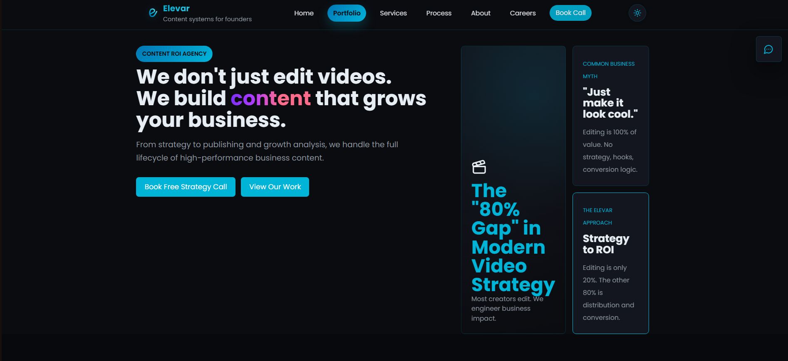
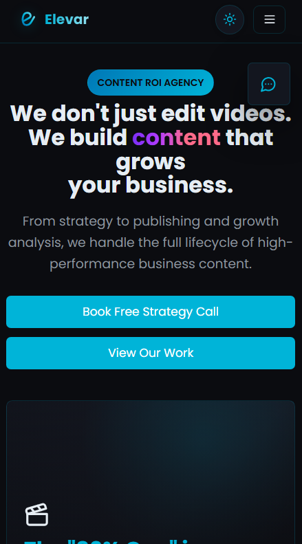
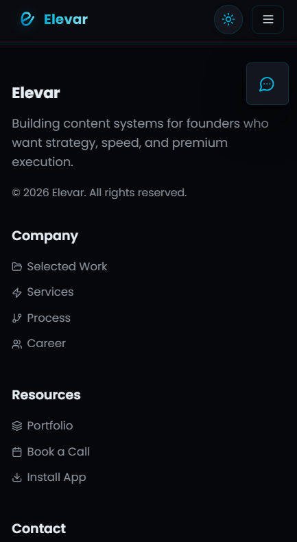

<p align="center">
  
</p>

<h1 align="center">Elevar 🚀</h1>

<p align="center">
  <strong>Strategic content engines for personal brand growth &amp; elevation.</strong><br />
  We don't just edit videos — we build content that grows your business.
</p>

<p align="center">
  
  
  
  
  
</p>

---

## ✨ What it is

**Elevar** is a content studio for founders and growing brands. The site presents its services, founder story, client feedback, and vertical video work in a quiet, monochrome interface.

> Content ROI Agency · Full-funnel content systems for founders &amp; personal brands.

## 🖼️ UI Preview

<table>
  <tr>
    <td align="center"><strong>Desktop</strong></td>
    <td align="center"><strong>Mobile</strong></td>
  </tr>
  <tr>
    <td></td>
    <td></td>
  </tr>
  <tr>
    <td colspan="2" align="center"></td>
  </tr>
</table>

## 🧩 Key Sections

- **Hero** — a direct introduction to Elevar and its content services.
- **Process** — an 8-step engine: Discovery → Strategy → Script → Pre-Prod → Production → Post → Publishing → Growth Analysis.
- **Services** — Video Editing, Content Strategy, AI Production, Social Management, Brand Content, and a Custom Bundle.
- **Portfolio** — vertical 9:16 reels showcasing selected work.
- **Production tools** — software and AI video generation tools used by the team.
- **Testimonials** — a static grid of client feedback.
- **About / Founder** — brand story with founder imagery.
- **Book a Call** — discovery-call capture flow.
- **Chat Support** — a lightweight conversational helper that routes visitors to the right next step.
- **Career** — open roles page.

## 🎨 Design Highlights

- 🌗 **Light / Dark mode** with a persistent theme toggle.
- 🌊 A subtle animated wave and light texture in both themes.
- 🎞️ **Framer Motion** interactions and scroll reveals.
- 🧱 A monochrome design system built with CSS variables.
- 📱 Fully **responsive** — looks sharp from phone to widescreen.
- 💬 Floating **chatbot button** for instant guidance.

## 🛠️ Tech Stack

| Layer | Tools |
|-------|-------|
| Framework | Next.js 14 (App Router, static export) |
| UI | React 18, Tailwind CSS, Radix UI primitives |
| Motion | Framer Motion |
| Icons | lucide-react |
| Login / signup | Clerk browser SDK |
| Career applications | EmailJS browser SDK with email-draft fallback |
| Booking | Embedded Google Form with email-draft fallback |
| Deploy | GitHub Pages (`/elevar` base path) |

## 🚀 Getting Started

```bash
# install dependencies
bun install        # or: npm install

# run the dev server
bun run dev        # http://localhost:3000

# build for production (static export to /out)
bun run build

# preview the production build
bun run start
```

> 💡 Production integrations and required GitHub repository secrets are documented in [SETUP_GUIDE.md](SETUP_GUIDE.md) and `.env.example`.

## 📁 Project Structure

```
app/
  page.tsx              # home (hero, process, services, portfolio, about)
  chat/                 # conversational support page
  book-call/            # discovery call capture
  career/               # open roles
  selected-work/        # portfolio detail
  components/           # Navigation, Footer, auth, testimonials, ...
components/ui/          # shared UI primitives
public/                 # logo, founder image, portfolio videos
docs/screenshots/       # UI previews
```

## 🌍 Deployment

The site is exported statically and served from **GitHub Pages** under the `/elevar` path. Production builds set `basePath` / `assetPrefix` automatically via `next.config.mjs`. Server API routes are not available on Pages; career submissions use EmailJS in the browser. Configure Clerk and EmailJS secrets before rebuilding to activate those integrations.

---

<p align="center">
  Made with ☕ &amp; a lot of <strong>content strategy</strong> by the Elevar team.
</p>
